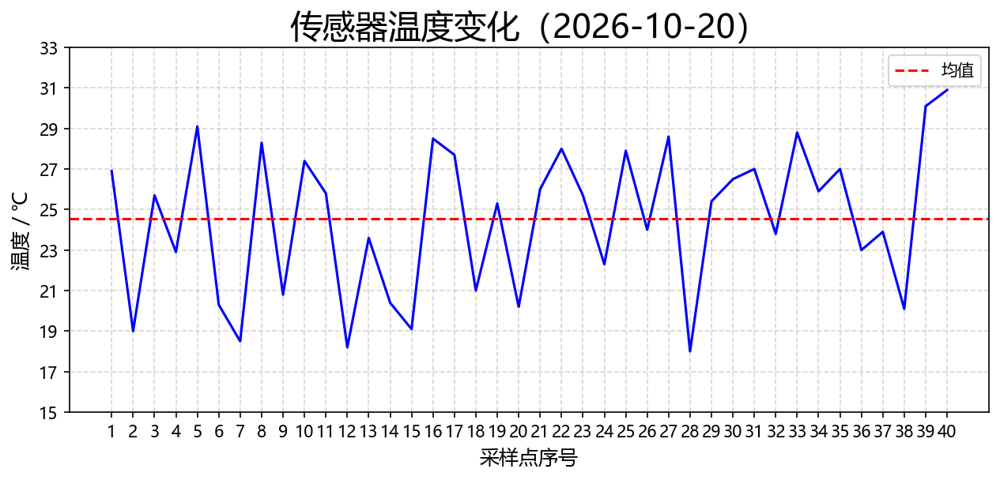
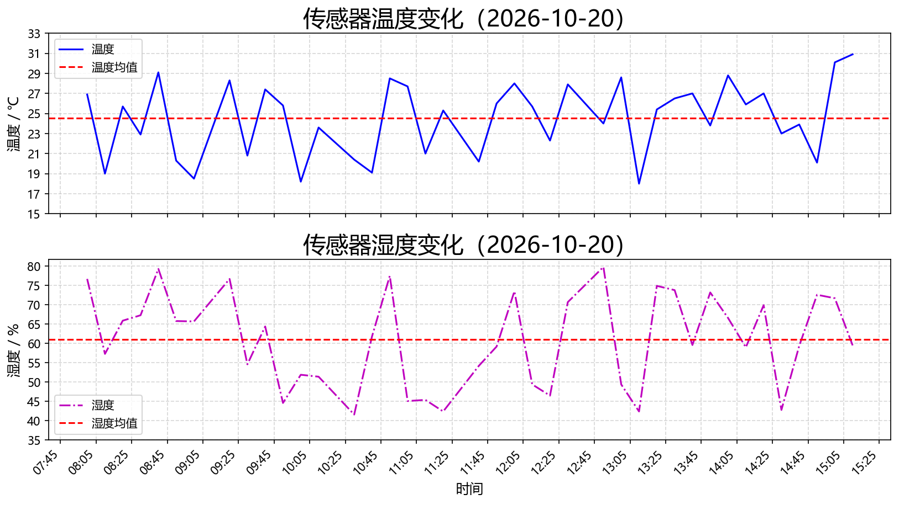

# 传感器日志分析

读一份温湿度传感器日志，跳过脏数据，算出统计量，画成两张图。

## 看到什么





上图是 40 个采样点的温度曲线与均值线；下图是温度、湿度双子图，共用时间轴。

## 怎么跑

```
pip install -r requirements.txt
python src/plot_sensor.py
```

脚本不会读取运行目录，数据路径和输出路径都从脚本自身位置推算，因此在任何目录下运行都可以。
输出写在 `figs/temp_humidity.png`。

## 数据格式

`data/sensor_log.csv` 共 44 条数据，其中 4 条是刻意构造的脏数据，清洗后剩 40 条有效。

要处理自己的数据，把 CSV 改名为 `sensor_log.csv` 放进 `data/` 覆盖即可，但必须满足：

| 要求 | 违反后果 |
|---|---|
| 第 1 行是表头 `time,temp,humidity` | 会被当成数据行，转换失败后跳过 |
| 每个数据行恰好 3 列 | 缺列/多列 → 跳过并打印原因 |
| 第 2、3 列必须是数字 | 转 `float` 失败 → 跳过并打印原因 |

跳过的行会打印行号和原因，不会静默丢弃。

## 历史错误

- matplotlib 中文变方块——需设 font.sans-serif，Windows 用 Microsoft YaHei
- ax[0] = plt.plot(...) 后报 AttributeError——plot() 返回列表不是 Axes，赋值覆盖了 Axes 
- 绝对路径导致更换设备无法使用——改用 __file__ 推算

## 作者

Yixuan Tong